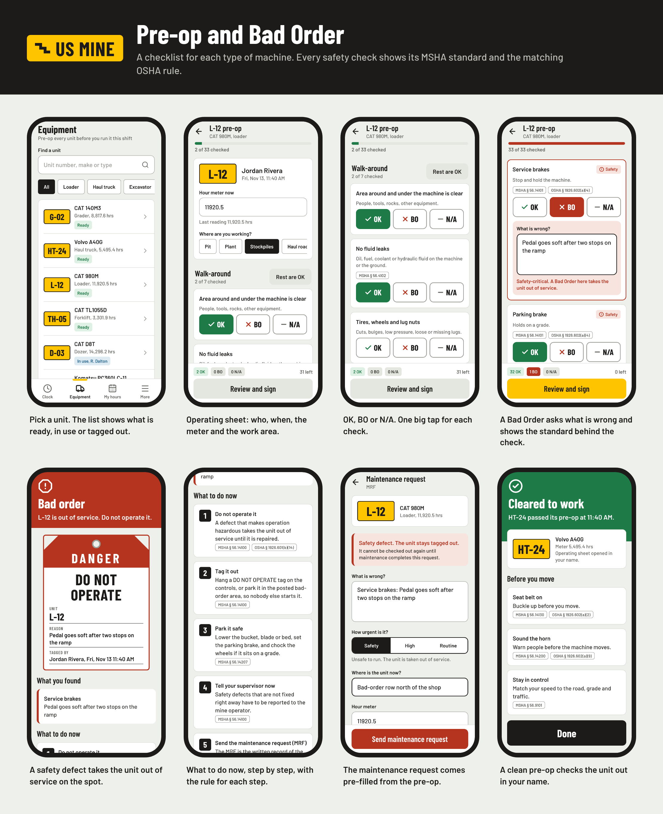
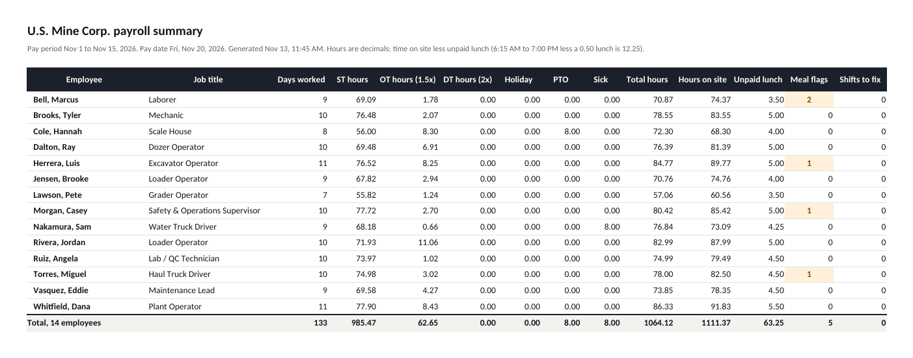

# US Mine Crew

Time clock, pre-operational inspections, maintenance requests and payroll hours for the crew at the U.S. Mine Corp. plant in Ione, California. One codebase builds the iPhone app, the Android app and a web version.

It replaces the paper time sheet, the pre-op clipboard and the maintenance request form, and it does the hours math so nobody has to.





The Excel exports look like this ([payroll sample](docs/samples/US-Mine-Payroll_sample.xlsx), [safety log sample](docs/samples/US-Mine-Safety-Log_sample.xlsx)):



## What it does

**For everyone on the crew**

- **Clock in and out with a GPS check.** A clock-in only goes through from inside the mine boundary. The location is read at the moment of the punch and never in the background.
- **Lunch is one tap.** Tap Start lunch and that is it. Thirty minutes later the app puts you back on the clock by itself and sends a notification that lunch is over. Nobody clocks back in. Lunch is unpaid and comes off the day as 0.50.
- **Lunch reminders.** The app counts down to the end of the fifth hour of work and reminds you 60, 30 and 15 minutes before it, and again when it passes.
- **Hours the way the timesheet does them.** Minutes become hundredths of an hour (15 min = .25, 45 min = .75). 6:15 AM to 7:00 PM with a 30-minute lunch is 12.75 − 0.50 = **12.25**.
- **Pay periods the way the checks are cut.** The 1st to the 15th is paid on the 20th, and the 16th to the end of the month is paid on the 5th. The clock screen shows the hours so far and the next payday. My hours splits the period into straight time, overtime and double time, the same lines as the pay stub.
- **What the check should come to.** Enter your hourly rate once and the app estimates gross pay for the period. The rate stays on your phone.
- **Pre-op any unit in a couple of minutes.** Big OK / BO / N/A buttons, a checklist for each type of machine, and the MSHA standard (with the matching OSHA rule) behind every safety check.
- **Bad Order guidance.** A safety defect takes the unit out of service, shows the steps to tag it out with the standard for each step, and pre-fills the maintenance request (MRF).
- **Equipment operating sheet.** Who ran which unit, from when to when, with the meter readings and fuel.

**For supervisors, safety and payroll**

- A live board: who is on site, who is close to their lunch deadline, which shifts have no clock-out, which units are tagged out.
- Time corrections with a required reason and a permanent audit trail.
- Payroll by employee for the pay period or any workweek: straight time, overtime and double time, with lunch flags for review.
- Paid leave: holiday, PTO and sick hours are entered by a supervisor, show as their own lines, and never count toward overtime.
- Maintenance request queue: open, in progress, completed and returned to service.
- Roster control: only names on the roster can create an account. Paste a whole list at once.
- **Excel exports** for payroll (summary, daily detail, paid leave, punch log, flags) and safety (pre-ops, Bad Order items, equipment use, MRFs, time on site).

## Where this build stands

This is a working preview. Every flow above runs, on sample data.

| | |
|---|---|
| **Runs today** | Time clock, GPS boundary check, lunch rules and reminders, pre-ops, Bad Order steps, MRFs, operating sheets, pay periods and payroll math, paid leave, pay estimate, corrections, roster, Excel export |
| **Sample data** | 14 made-up employees, 14 made-up units, about five weeks of punches and two weeks of pre-ops. Nothing in it is a real US Mine record |
| **To confirm with payroll** | Which way a pay date moves when the 5th or 20th is a weekend or bank holiday (the app moves it to the banking day before), and which holidays are paid |
| **Kept on the device** | All data lives on the phone or browser it was entered on. Two phones do not see each other's punches yet |
| **Not connected yet** | The shared cloud database and real Apple, Google and Microsoft sign-in. The buttons and the account screens are built; they need the backend behind them |
| **Not yet tried on a phone** | The iPhone and Android bundles build cleanly, and the app has been driven end to end in a browser. It has not been installed on a physical phone yet |
| **Notifications** | On a phone, the lunch reminders and the lunch-is-over notice are handed to the operating system, so they arrive with the app closed or the phone locked. In a browser they only arrive while the page is open. Delivery on a real phone has not been tried yet |

Going live for the whole crew needs the cloud backend first, so a supervisor's phone can see everyone's punches.

## Run it

```bash
npm install
npm run web        # opens in a browser
npm start          # then scan the QR code with Expo Go on a phone
npm test           # 187 unit tests: hours, lunch rules, overtime, pay periods, GPS, checklists, Excel
npm run typecheck
npm run build:preview   # packs the whole app into one HTML file in preview/ that opens anywhere
```

The sign-in screen has two shortcuts, "Open as an employee" and "Open as a supervisor", that skip account setup. The Clock screen has preview controls for pretending the phone is at the mine or in town, so the GPS check can be shown from anywhere. While at lunch, "Skip to the end of lunch" shows what happens when the 30 minutes are up without waiting for them.

## How the hours are figured

1. Punches count to the minute.
2. Time on site becomes a decimal: minutes ÷ 60, rounded to two places.
3. Lunch becomes a decimal the same way and comes off: paid = on site − lunch.
4. Days add up to weeks as whole hundredths, so the app, the timesheet and the Excel export always agree.

Lunch ends by itself 30 minutes after it starts, so it comes off as 0.50. A second lunch on a long day works the same way. If a supervisor corrects a lunch to a different length, the corrected minutes come off instead. Paid rest breaks can be logged but are never taken off.

## How lunch works

1. The person taps **Start lunch**. That is the only tap.
2. The app writes down the end of the lunch right then: 30 minutes after the start. The screen turns blue and counts down.
3. When the 30 minutes are up the person is back on the clock, whether the app is open or not. Nothing has to be running for this to happen, because being at lunch is worked out from the two times.
4. The phone shows a notification: "Lunch is over. You are back on the clock as of 11:30 AM." If the app is open it says so on screen as well.

A lunch cannot be cut short or stretched from the phone, and there is no clock-out while it is running. There is no punch at the end of lunch, so no location is read then: the app does not check that someone is back at the mine when their lunch ends. Supervisors can still correct lunch times, with a reason, from the shift record.

Overtime follows California rules: over 8 hours in a day or 40 straight-time hours in a week is time-and-a-half, over 12 in a day is double time, and the seventh-day rule applies. The lunch deadline follows California Labor Code §512: the first meal starts before the end of the fifth hour. Flags are for a supervisor to review. Nothing is paid or docked automatically.

## Pay periods and paydays

| Pay period | Paid on |
|---|---|
| The 1st to the 15th | The 20th of the same month |
| The 16th to the end of the month | The 5th of the next month |

- **A pay date on a weekend or bank holiday moves to the banking day before it.** Saturday, December 5, 2026 becomes Friday, December 4. Bank holidays are the Federal Reserve's; a holiday on a Sunday closes banks the Monday after. This is the app's assumption until payroll confirms which way the date moves. The schedule is `PAY_SCHEDULE` in `src/domain/payPeriod.ts`.
- **Overtime is figured by the workweek, Sunday to Saturday,** then added up for the days that fall in the pay period. A workweek that straddles two pay periods is worked out whole, and each day's hours go to the period the day is in.
- **Hours come in the pay stub's lines:** ST (straight time), OT (1.5 times), DT (2 times), and holiday, PTO and sick hours. Paid leave is paid at straight time and never counts toward overtime.
- **The pay estimate** is hours times the rate the person entered, line by line, each line rounded to the cent: ST at the rate, OT at 1.5 times, DT at 2 times, leave at the rate. It is gross pay before taxes and deductions. The pay stub is the official figure.

## The clock-in boundary

The boundary is a circle around the pin at 38.33419° N, 120.94551° W, 1,000 m (0.62 mi) out by default, which is about 776 acres.

The Central Valley Water Board permit for the site (Order R5-2025-0042, June 2025) describes the US Mine Ione Plant as about 1.25 miles south of Ione on roughly 3,570 acres, of which about 402 acres have been mined, built on or reclaimed, all south of town and west of Highway 124. A circle the size of the full 3,570 acres centered on the pin would reach the south side of town, so the default covers the working area and stops about 0.8 miles short of downtown.

Supervisors can change the radius in the app (Crew → Mine boundary). To use the true property outline instead, set `polygon` on the site in `src/domain/site.ts`; the parcel numbers from the permit are listed there.

## Standards

Ione is a surface non-metal mine, so the governing federal standards are MSHA's 30 CFR Part 56. Each safety check also shows the matching federal OSHA rule (29 CFR 1910 / 1926) as a cross-reference. In California, Cal/OSHA's Mining and Tunneling Unit also inspects surface mines under the Title 8 Mine Safety Orders.

The summaries in the app are a field aid in plain language. They are not legal advice.

## Making it yours

| To change | Edit |
|---|---|
| Pre-op checklists | `src/domain/templates.ts` — plain data, one list per type of machine |
| Standards and Bad Order steps | `src/domain/standards.ts` |
| Lunch and overtime rules | `CA_RULES` in `src/domain/time.ts` |
| Pay periods, paydays and bank holidays | `src/domain/payPeriod.ts` |
| Boundary | `src/domain/site.ts`, or in the app |
| Sample crew and fleet | `src/store/seed.ts` |
| Colours and type | `src/theme/theme.ts` |

The real roster and fleet can also be entered in the app: Crew → Roster → Add people → Paste a list.

## How the code is laid out

```
App.tsx                 fonts, storage, navigation
src/domain/             the rules, with tests: hours, lunch, overtime, pay periods, GPS, checklists, standards
src/store/              app state (saved on the device), its migrations and the sample data
src/services/           GPS, notifications, Excel writer, reports, file sharing
src/components/         buttons, time card, day table, pay estimate, danger tag, site map
src/screens/            auth, clock, equipment, hours, more, supervisor
```

Built with Expo (React Native) and TypeScript.

## Before the first store release

- Connect the backend and turn off preview mode (`EXPO_PUBLIC_DEMO=0`).
- Set the real app identifiers in `app.json` (`ios.bundleIdentifier`, `android.package`). They are placeholders now and cannot be changed after the first release.
- Apple Developer Program and Google Play Console accounts in the company's name.
- A privacy policy that covers the location check.
