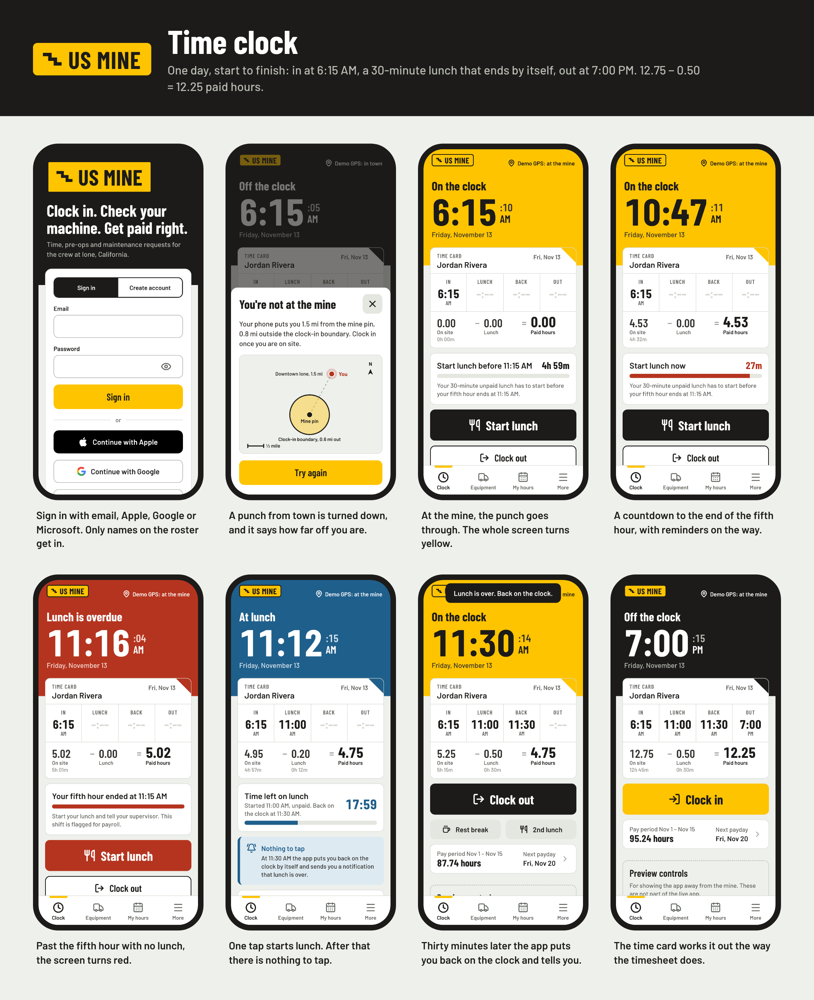
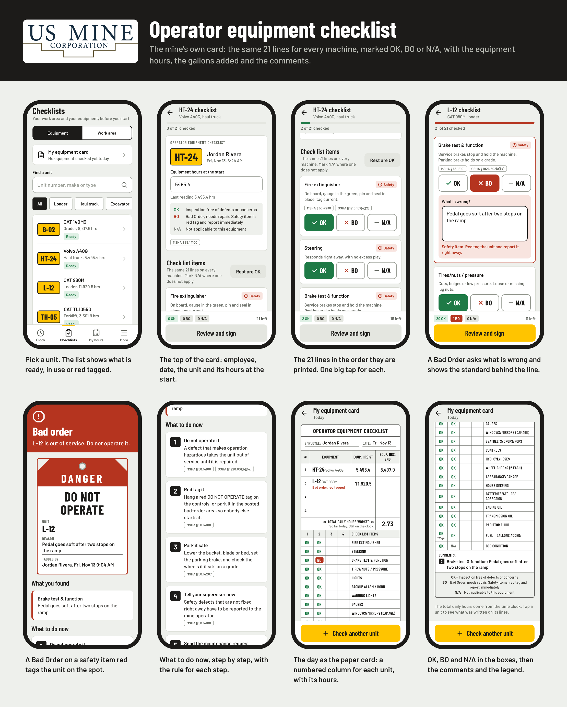
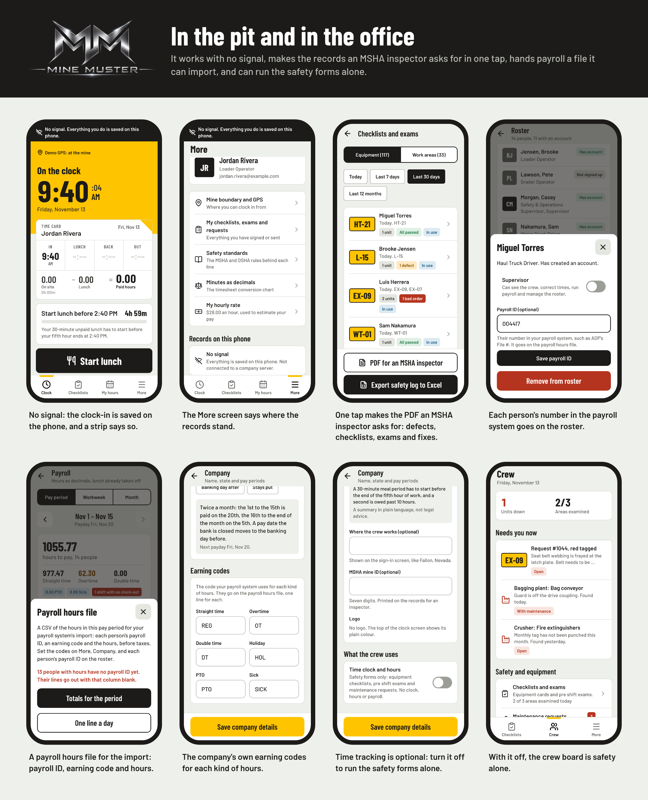
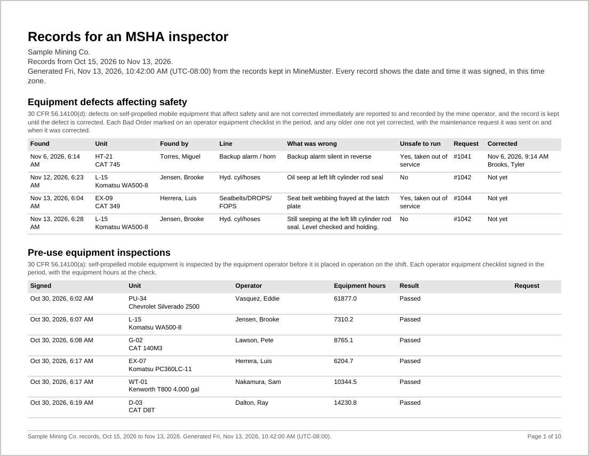

# MineMuster

Time clock, the equipment checklist, the pre shift exam of each work area, maintenance requests and payroll hours for a mine crew. One codebase builds the iPhone app, the Android app and a web version.

Any mine can use it. Each company sets its own name, the state whose hours rules apply, its logo and its pay periods (or none). It was built first from the paper forms of U.S. Mine Corp.'s plant, and that company's version is kept as a company setting in a private build.

It replaces the paper time sheet, the Operator Equipment Checklist card, the Pre Shift Exam sheets and the Maintenance Request form, and it does the hours math so nobody has to.









The Excel exports look like this ([payroll sample](docs/samples/Sample-Mining-Co-Payroll_sample.xlsx), [safety log sample](docs/samples/Sample-Mining-Co-Safety-Log_sample.xlsx)). The PDF for an inspector is made from the same records ([sample](docs/samples/Sample-Mining-Co-MSHA-Records_sample.pdf)):




## What it does

**For everyone on the crew**

- **Works with no signal.** Quarries, pits and underground mines often have none. Clocking in, the equipment checklist, lunch, the pre shift exam and maintenance requests all work without it: a record is saved on the phone the moment it is signed. A strip across the top says when the phone has no signal, and the More screen says where the records stand. GPS needs no cell signal, only a view of the sky.
- **Clock in and out with a GPS check.** A clock-in only goes through from inside the mine boundary. The location is read at the moment of the punch and never in the background.
- **Lunch is one tap.** Tap Start lunch and that is it. Thirty minutes later the app puts you back on the clock by itself and sends a notification that lunch is over. Nobody clocks back in. Lunch is unpaid and comes off the day as 0.50.
- **Lunch reminders, where the state sets a lunch deadline.** In California the app counts down to the end of the fifth hour of work and reminds you 60, 30 and 15 minutes before it, and again when it passes. In a state with no deadline there is no countdown; see [Rules by state](#rules-by-state).
- **Hours the way the timesheet does them.** Minutes become hundredths of an hour (15 min = .25, 45 min = .75). 6:15 AM to 7:00 PM with a 30-minute lunch is 12.75 − 0.50 = **12.25**.
- **Pay periods the way the company cuts its checks, or none.** A supervisor sets the schedule: every week, every two weeks, twice a month or once a month, paid a day of the month or so many days after the period ends. The clock screen then shows the hours so far and the next payday. A company that sets none sees hours by the workweek and the month. My hours splits each into straight time, overtime and double time, the same lines as the pay stub. Every figure is before taxes.
- **What the check should come to.** Enter your hourly rate once and the app estimates gross pay for the period. The rate stays on your phone.
- **The Operator Equipment Checklist, the same card for every machine.** The 21 lines of the paper card, in its order and its wording, marked OK, BO or N/A with one big tap each. It takes the equipment hours at the start and the end, the gallons added and the comments. Where a standard applies to a line, the line cites it: the MSHA standard, and the matching OSHA rule where there is one.
- **Your card for the day.** Every unit you check gets a numbered column, laid out the way the paper is, with the total daily hours worked filled in from the time clock.
- **Bad Order guidance.** A Bad Order on a safety item red tags the unit, shows the steps to take with the standard for each one, and pre-fills the maintenance request.
- **The Pre Shift Exam of your work area.** The area's own sheet, each line checked for guarding, electrical and safe access, then the 20 conditions of the second page, with room for "Other (specify)" lines. Anything found stays open on the area until the date it was fixed is recorded.
- **Maintenance requests like the paper form.** By, date, location and problem, then assigned to, date completed, time spent, completed by and remarks. A request can be for a unit or for anything else in the plant.

**For supervisors, safety and payroll**

- A live board: who is on site, who is close to their lunch deadline (where the state sets one), which shifts have no clock-out, which units are red tagged, and which work-area conditions are still open.
- Time corrections with a required reason and a permanent audit trail.
- Payroll by employee for the pay period, any workweek or any month: straight time, overtime and double time, with lunch flags for review where the state's meal rules call for them.
- Paid leave: holiday, PTO and sick hours are entered by a supervisor, show as their own lines, and never count toward overtime.
- Everyone's equipment cards and pre shift exams by day, each one opening as the paper it replaces.
- Maintenance request queue: assign a request, start it, and complete it with the remarks and the time spent. Completing a request that came from an exam puts the date fixed on that exam.
- Area sheets: type in the sheet for a new work area, one line of the paper to a line.
- Roster control: only names on the roster can create an account. Paste a whole list at once.
- **A PDF for an MSHA inspector.** One tap on the safety log makes the records an inspector asks to see, for the day, the last 7 or 30 days or the last 12 months: the equipment defects that affect safety and when each was corrected (30 CFR 56.14100(d)), every pre-use equipment inspection (56.14100(a)), every pre shift exam and every condition it found, with the date it was corrected (56.18002). Every record shows the date and time it was signed, and the file says when it was made and in which time zone. A defect or condition from before the period that is still not corrected is carried into it. A supervisor can add the mine's MSHA mine ID on More → Company to print it at the top.
- **A payroll hours file** for the import of the company's payroll system: a plain CSV with each person's payroll ID, an earning code and the hours, before taxes, as totals for the period or one line a day. A supervisor sets the company's own earning codes on More → Company and each person's payroll ID (ADP's File #, for one) on the roster. It is made from the same payroll as the Excel export, so the two agree to the hundredth. QuickBooks Online's import maps columns from the first row, and Sage 100 and Sage 300 CRE let the company set the layout. ADP Workforce Now wants its own paydata layout, so a ready-made ADP file, like any vendor's, waits on that system's own import template (see Payroll systems below).
- **Time tracking is optional.** A company can turn off the time clock on More → Company and use the app for the safety forms only: the equipment checklist, pre shift exams, maintenance requests and the PDF for an inspector. The Clock and My hours tabs, payroll, corrections, lunch reminders and the hourly rate go away, and the app opens on the checklists.
- **Excel exports** for payroll (summary, daily detail, paid leave, punch log, flags) and safety (equipment checklists with the 21 lines as columns, Bad Order items, equipment use, pre shift exams, the conditions found, every line of every exam, maintenance requests, time on site).

## Where this build stands

This is a working preview. Every flow above runs, on sample data.

| | |
|---|---|
| **Runs today** | Time clock, GPS boundary check, lunch rules and reminders, the equipment checklist and the daily card, Bad Order steps, pre shift exams and their open conditions, maintenance requests, area sheets, pay periods and payroll math, paid leave, pay estimate, corrections, roster, Excel export, the payroll hours file, the PDF for an MSHA inspector, the safety forms without the time clock, working with no signal |
| **Sample data** | 14 made-up employees, 14 made-up units, 3 made-up work areas, about five weeks of punches and two weeks of checklists and exams. Nothing in it is a real US Mine record |
| **The mine's own sheets** | The equipment checklist and the conditions page are the mine's, line for line. The area sheets in this repository are made-up samples: a build names the real ones in `.env.local`, or a supervisor types them in (see The paper forms) |
| **Settled with the crew** | The safety items that always red tag a unit: fire extinguisher, steering, brakes, backup alarm / horn, seatbelts and controls. N/A stays on the pre shift exam. The one spelling the app puts right on the conditions page stays put right. There is a swing shift as well as day and night |
| **To confirm with the mine** | The hours each shift runs (see Pre Shift Exam under The paper forms for what the app assumes until then). What "DROPS" on the card stands for (it is shown as printed). Whose name goes on "Completed by" when a supervisor closes out a request for a mechanic (the app asks). What the "Lead Check" blank on some area sheets is for and who fills it in (it is not built yet) |
| **To confirm with payroll** | Which way a pay date moves when the 5th or 20th is a weekend or bank holiday (the app moves it to the banking day before), and which holidays are paid |
| **Kept on the device, sent where a build names a server** | Every record is saved on the phone or browser it was entered on. A build that names a company server (see [Connecting a phone to the company server](#connecting-a-phone-to-the-company-server)) lets a person sign in, join their company with its join code and send the phone's records there: every record the server does not have yet, by a version of each record, sent in batches whenever there is signal and tried again until it gets through. The hourly rate, accounts, passwords and the sample crew's records are never sent, and a preview build sends nothing. Until the server's record store (`push_records`, `my_companies`) is on the Supabase project, a person cannot connect a phone: joining says the company server is not ready for this yet, and every record stays on the phone. The office dashboard reads what the phones send, and a supervisor changes the roster, the fleet, the area sheets and the company settings there (`dashboard/README.md`, What it writes). Phones receive those four: what is saved there reaches each phone the next time it is open with signal (see [What a phone receives](#what-a-phone-receives)). Two phones do not see each other's punches, checklists, exams or requests: those are not received |
| **Keep the paper for now** | The standard asks for exam records to be kept for a year and shown to MSHA on request. Until the shared backend holds them, a record made in this preview lives on one device, so it does not replace the paper yet |
| **Not connected yet** | Real Apple, Google and Microsoft sign-in, and signing in to the app itself with the server's account. The buttons and the account screens are built; they need the backend behind them. Signing in to the company server with an email and a password is built (More → Company account) |
| **Not yet tried on a phone** | The iPhone and Android bundles build cleanly, and the app has been driven end to end in a browser. It has not been installed on a physical phone yet |
| **Notifications** | On a phone, the lunch reminders and the lunch-is-over notice are handed to the operating system, so they arrive with the app closed or the phone locked. In a browser they only arrive while the page is open. Delivery on a real phone has not been tried yet |

Going live for the whole crew needs the cloud backend first, so a supervisor's phone can see everyone's punches.

## Run it

```bash
npm install
npm run web        # opens in a browser
npm start          # then scan the QR code with Expo Go on a phone
npm test           # 909 unit tests: hours, lunch rules, overtime, pay periods, the company, roster, GPS, the checklist, exams, Excel, the inspector PDF, what is sent to the server, what a phone receives and connecting to it, the payroll hours file
npm run typecheck
npm run build:preview   # packs the whole app into one HTML file in preview/ that opens anywhere
```

The preview file is kept under 2 MB, which is as large as an HTML file can be and still open as a preview in the Claude phone app; a larger one has shown there as code. Its fonts go in as the compressed copies in `scripts/preview-fonts` to keep it that small, and the packer warns when the file gets close.

The sign-in screen has two shortcuts, "Open as an employee" and "Open as a supervisor", that skip account setup. (A build that names its own roster has no sample people to open as; it has one shortcut, for the person the build is made for.) The Clock screen has preview controls for pretending the phone is at the mine or in town, so the GPS check can be shown from anywhere. While at lunch, "Skip to the end of lunch" shows what happens when the 30 minutes are up without waiting for them.

## Signing in under your own name

Only names on the roster can create an account, and the sample crew is made up. To use a build as yourself, name the person the build is for in a file called `.env.local` in the project folder:

```
EXPO_PUBLIC_ROSTER_OWNER=First Last
```

That person is always on the roster as a supervisor. They create an account with their own name, email and password like anyone else, start with no hours, and, on a phone not joined to a company, can add the rest of the crew from Crew → Roster. In a live build this is also how the first supervisor gets in. On a phone joined to its company, people are changed on the dashboard's Roster page instead (see [What a phone receives](#what-a-phone-receives)).

### The whole roster

A build can name everyone at the mine as well, each with their job title, so every person can create an account under their own name. In `.env.local`, one person to a line: the name, then the job title, then `supervisor` for a supervisor, with a bar between them. `\n` ends a line. Put the value in single quotes, so a nickname can keep its double quotes:

```
EXPO_PUBLIC_ROSTER='Ortiz, Sam | Crusher\nQuinn, Riley J | Maintenance | supervisor\nVance III, Lee "Buck" | Electrician'
```

- A name is read as "Last, First", the way a sign-in sheet lists it. A middle initial, a nickname in quotes and a "Jr" or "III" stay where the mine wrote them.
- A person signs up with their first and last name. They can leave off the middle initial and the "III", and someone who goes by their nickname can use it. When a name fits more than one person, the app asks for it the way it is on the roster.
- Everyone a build names starts with no hours and no records. Nothing is made up for a real person.
- The person named in `EXPO_PUBLIC_ROSTER_OWNER` is a supervisor whatever their line says. Everyone else is crew until their line says `supervisor`, or a supervisor changes it on the Roster screen.

**A build that names its roster has nobody made up in it.** The sample crew and their sample hours, checklists, exams and requests are left out. It opens with the mine's own people, the area sheets and the equipment list, and nothing that happened: the records are the crew's to make. The sign-in screen offers one shortcut, "Open as" the person the build is made for, and the More screen can clear the device back to that start. What such a build saves on a device is kept apart from the sample data an earlier preview may have saved there.

To show the app with a few weeks of history in it, keep the samples beside the real roster:

```
EXPO_PUBLIC_SAMPLE_CREW=1
```

The made-up people are then marked "Sample" on the Roster screen, and one who happens to have the last name of someone on the real roster starts under a spare one, so the made-up hours are not taken for a real person's. The sample history is never moved onto real people. (`EXPO_PUBLIC_SAMPLE_CREW=0` starts a build that names nobody with none, too.)

`.env.local` is not committed, and that is the point: **this repository is public.** Keep real names, pay figures and other personal details out of the code, out of `src/store/seed.ts`, and out of the screenshots and sample workbooks in `docs/`.

## The paper forms

Three of the mine's paper forms are built in. The app keeps their wording and their order, so a record reads like the sheet it replaces.

**Operator Equipment Checklist.** One card for every piece of equipment at the mine. Its 21 lines are in `src/domain/templates.ts` exactly as printed, from Fire extinguisher to Bed condition, each marked OK, BO or N/A:

```
OK = inspection free of defects/concerns
BO = Bad Order, Needs Repair (Safety items; red tag and report immediately.)
N/A = Not applicable to specific equipment
```

That is the legend at the foot of the card, word for word, and it is what the app shows. The card does not say which lines are the safety items, so the app has to: fire extinguisher, steering, brakes, backup alarm / horn, seatbelts and controls. A Bad Order on one of those always red tags the unit. A note written on a Bad Order goes on the record only while the line is a Bad Order; change the line back to OK and the note is withdrawn with it.

The unit goes on the person's card for the day with its equipment hours at the start. Ending use adds the hours at the end and any gallons added. The card screen lays the day out as the paper does: up to four numbered columns against the lines, the comments, and the legend. A fifth unit starts a second card.

**Pre Shift Exam.** The examination of a work area before work starts in it on the shift. Page one is the area's own sheet: each line is checked for guarding, electrical and safe access. Page two is the same for every area: 20 conditions, each OK or Bad Order. The paper has only those two; the app adds N/A, so a line that does not apply can still be answered. On the phone a line is one tap for OK or N/A; a Bad Order asks which column it is in and what was found. Some sheets have a single OK/BO column in place of the three: a Bad Order on one of those asks only what was found, and the record is shown with the one column. A Bad Order stays open on the area, and on the supervisor's board, until its date fixed is recorded. That happens one of two ways: the examiner or a supervisor marks it fixed, or the maintenance request it was sent on is completed.

A few things the phone does that the paper leaves to the person:

- The "Date+Shift" blank is filled in: the date, and the shift, which is day, swing or night. The form starts on the shift the person clocked in for, and they can change it. Until the mine gives the hours its shifts run, the app takes day crews to come in from 3 AM, swing from 11 AM and nights from 5 PM, and uses that for the starting choice only. The work-area list names the shift an area was last examined for, so the next crew can see that theirs is still to do; it does not work out for them that an exam is due.
- What is written goes under the line it belongs to, under the paper's "Notes / Date fixed" heading, because a phone has no room for that column.
- A line with a condition still open says so when the area is examined again, and "Rest are OK" passes over it, so it is looked at and marked by hand. Marking it OK does not close the earlier finding: only its own date fixed does. The same line found again on a later exam is a record of its own.
- A Bad Order marked as a danger shows as "Danger, keep out" wherever the area is listed, ahead of anything else that is open.
- Leaving a half-filled exam or checklist asks first, so a back swipe in gloves does not throw the marks away. Each is signed once, however many times the button lands.

**Maintenance Request.** By, date, location and problem when it is sent; assigned to, date completed, time spent, completed by and remarks as the work is done. A supervisor assigns it. A supervisor, or the person it is assigned to, starts and completes it; the person it is assigned to finds it on their Clock screen and under My records. "Completed by" is whoever closes it. A supervisor closing one out for the person it is assigned to is asked who did the work, and the history shows who entered it. A request is only ever for something that is there: a unit in the fleet, a checklist made on that unit, or a Bad Order that is still open and has no request yet. The crew calls the form an MRF, so the exports head its number "MRF #".

### Area sheets

Every work area has its own sheet. The three in this repository are made-up samples, because the real sheets list the plant's own equipment and the repository is public. There are two ways to put the real ones in:

- **In the app:** Crew → Area sheets → Add an area sheet. Type the name of the area, then one line of the paper sheet on each line. An area can start with no lines of its own and still get the conditions page. Turn on "One OK/BO column" for a sheet that marks each line once.
- **For a build:** name them in `.env.local`. The name of an area, then each line of its sheet, with a blank line before the next area. `\n` ends a line, and `[OK/BO]` after the name of an area gives its sheet the one column:

```
EXPO_PUBLIC_AREA_SHEETS="North plant\nFeed bin\nConveyor 4\nJaw crusher\n\nCore shed [OK/BO]\nCore saw\nCore racks"
```

A signed exam keeps the lines and the columns it was made on, so changing a sheet later never changes a record.

## How the hours are figured

1. Punches count to the minute.
2. Time on site becomes a decimal: minutes ÷ 60, rounded to two places.
3. Lunch becomes a decimal the same way and comes off: paid = on site − lunch.
4. Days add up to weeks as whole hundredths, so the app, the timesheet and the Excel export always agree.

Lunch ends by itself 30 minutes after it starts, so it comes off as 0.50. A second lunch on a long day works the same way. If a supervisor corrects a lunch to a different length, the corrected minutes come off instead. Paid rest breaks can be logged but are never taken off.

## How lunch works

1. The person taps **Start lunch**. That is the only tap.
2. The app writes down the end of the lunch right then: 30 minutes after the start. The screen turns blue and counts down.
3. When the 30 minutes are up the person is back on the clock, whether the app is open or not. Nothing has to be running for this to happen, because being at lunch is worked out from the two times.
4. The phone shows a notification: "Lunch is over. You are back on the clock as of 11:30 AM." If the app is open it says so on screen as well.

A lunch cannot be cut short or stretched from the phone, and there is no clock-out while it is running. There is no punch at the end of lunch, so no location is read then: the app does not check that someone is back at the mine when their lunch ends. Supervisors can still correct lunch times, with a reason, from the shift record.

## Rules by state

Overtime and meal periods follow the state the company is in, set on More → Company, which shows the rules in two plain sentences. A lunch is 30 minutes and unpaid in every state; what changes is when one is owed and how overtime is figured.

| | Federal law (any state with no rules of its own) | California |
|---|---|---|
| Overtime | Over 40 hours in a workweek | Over 8 hours a day or 40 straight-time hours a week; double time over 12 a day; the seventh-day rule |
| Meal period | None required | 30 minutes, started before the end of the fifth hour; a second past 10 hours |
| On the clock screen | Start lunch, no countdown, no reminders | A countdown to the end of the fifth hour and reminders before it |
| Lunch flags | None | Late lunch, no lunch, short lunch, second meal due |

Every state and the District of Columbia was checked against its own statute, rule or labor department, and checked again independently (16 November 2026). The rules are in `src/domain/stateRules.ts`, each with its citation:

- **Daily overtime:** Alaska (past 8 hours), California (past 8, double time past 12) and Colorado (past 12). Everywhere else overtime is past 40 hours in the workweek.
- **Seventh day:** California (8 hours at time and a half, the rest double) and Kentucky (every hour at time and a half), when all seven days of the workweek are worked.
- **A meal with a time it must start by** (countdown, reminders, late-lunch flag): California, Illinois, Kentucky, Massachusetts, Maine, Nevada, New Hampshire, Oregon and Washington.
- **A meal owed on a long shift, with no fixed start time** (no-lunch flag only): Colorado, Connecticut, Delaware, Minnesota, North Dakota, New York, Rhode Island, Tennessee and West Virginia.
- **Said, not applied,** where a rule depends on something the app does not know or may not reach a mine: Nevada's daily overtime (only under 1.5 times the minimum wage), New York's clock-time meal windows, Oregon's manufacturing overtime, Rhode Island's Sunday and holiday premium, Florida's ten-hour rule for manual labor, Nebraska's lunch law and Vermont's reasonable opportunity to eat. The Company screen shows these notes.

A collective bargaining agreement or a written agreement can change several of these rules. Flags are for a supervisor to review. Nothing is paid or docked automatically. The summaries are plain language, not legal advice.

## Pay periods and paydays

A supervisor sets them on More → Company. The sample company pays twice a month:

| Pay period | Paid on |
|---|---|
| The 1st to the 15th | The 20th of the same month |
| The 16th to the end of the month | The 5th of the next month |

| Schedule | Periods | Paid |
|---|---|---|
| Every week | Seven days from any first day the company gives | So many days after the last day |
| Every two weeks | Fourteen days from that first day | So many days after the last day |
| Twice a month | The 1st to the 15th, the 16th to the end of the month | A day of the month for each half, or days after |
| Once a month | The 1st to the last day | A day of the month, or days after |
| No pay periods | Hours are shown by the workweek and the month | |

- **A pay date on a weekend or bank holiday moves the way the company says:** to the banking day before, to the banking day after, or not at all. Saturday, December 5, 2026 becomes Friday, December 4 when it moves back. Bank holidays are the Federal Reserve's; a holiday on a Sunday closes banks the Monday after. The rules are in `src/domain/payPeriod.ts`.
- **Overtime is figured by the workweek,** then added up for the days that fall in the pay period or the month. A workweek that straddles two pay periods is worked out whole, and each day's hours go to the period the day is in.
- **Hours come in the pay stub's lines:** ST (straight time), OT (1.5 times), DT (2 times), and holiday, PTO and sick hours. Paid leave is paid at straight time and never counts toward overtime.
- **The pay estimate** is hours times the rate the person entered, line by line, each line rounded to the cent: ST at the rate, OT at 1.5 times, DT at 2 times, leave at the rate. It is gross pay before taxes and deductions. The pay stub is the official figure.

## Payroll systems

The payroll hours file is plain CSV, one line for each person and kind of hours:

| Employee ID | Last name | First name | Period start | Period end | Earning code | Hours |
|---|---|---|---|---|---|---|
| 004417 | Torres | Miguel | 2026-11-01 | 2026-11-15 | REG | 80.00 |
| 004417 | Torres | Miguel | 2026-11-01 | 2026-11-15 | OT | 9.50 |

With one line a day, a Date column takes the place of the two period columns. Dates are written `YYYY-MM-DD` and hours as decimals with two places. A field a spreadsheet would read as a formula is written with an apostrophe in front.

What the vendors' own pages say, as far as it could be checked (their help sites could not be opened from where this was built, so each point is from search excerpts of the vendor's own pages and is to be checked against the company's own account before relying on it):

- **QuickBooks Online** imports Time Activities from a CSV and maps the columns from the first row. QuickBooks Online Payroll has no documented file import of hours; Intuit points to QuickBooks Time. QuickBooks Desktop's IIF format is no longer supported by Intuit.
- **ADP Workforce Now** takes a paydata file as a CSV whose first three columns are Co Code, Batch ID and File #, followed by hours by earning code. The rest of the layout is in the client's own ADP import guide.
- **Sage 100 Payroll** imports hours through a Visual Integrator job the company builds to match its file, and **Sage 300 CRE** imports time in the column order the company sets up. **Sage 50** imports time tickets with durations as hours and minutes.

So the file is built to be mapped, and a ready-made layout for one system can be added once that system's own import template is in hand.

## The clock-in boundary

The boundary is a circle around a pin on the mine, 1,000 m (0.62 mi) out by default, which is about 776 acres, or a surveyed outline in its place (`polygon`). No mine's location is written into the code:

- **A build names its site with the company,** in `EXPO_PUBLIC_COMPANY`: `"site": {"name": "...", "lat": 0.0, "lng": 0.0, "radiusM": 1000, "town": {"name": "...", "lat": 0.0, "lng": 0.0}}`. The town is optional; when it is there, the boundary screen and the map show how far the boundary stays from it.
- **A supervisor sets it in the app** on More → Mine boundary: standing on the mine, "Put the pin where I am" moves the pin there, and the buttons size the circle.
- **The sample company's site is made up:** round numbers in open desert, with a made-up town about a mile and a half off.
- **Until a site is set,** a clock-in is turned down with a note to ask a supervisor to set the boundary. Clocking out and starting lunch are never blocked by location.

## Standards

The app's forms are for surface metal and nonmetal mines, so the governing federal standards are MSHA's 30 CFR Part 56. Each safety check also shows the matching federal OSHA rule (29 CFR 1910 / 1926) as a cross-reference. In California, Cal/OSHA's Mining and Tunneling Unit also inspects surface mines under the Title 8 Mine Safety Orders.

- The equipment checklist is the operator's inspection before equipment is placed in operation on the shift, 30 CFR 56.14100.
- The pre shift exam is the examination of working places, 30 CFR 56.18002. Its record names who made the examination, the date, the areas examined and each condition found, and the date a condition is corrected is added to it. The app's exam record carries each of those.
- Two lines of the conditions page fall under other parts of 30 CFR: container labels (Part 47) and hearing protectors (Part 62).
- No standard is cited beside dust control or respiratory protection. 30 CFR 56.5005 was being revised when the list was written, so those two lines carry no reference until the current text is checked.

Only standards whose text has been checked are cited. The summaries in the app are a field aid in plain language. They are not legal advice.

## Making it yours

| To change | Edit |
|---|---|
| Equipment checklist lines, and which are safety items | `src/domain/templates.ts` |
| Pre shift exam columns and the 20 conditions | `src/domain/areaExam.ts` |
| Area sheets | In the app (Crew → Area sheets), or `EXPO_PUBLIC_AREA_SHEETS` in `.env.local` |
| Roster | In the app (Crew → Roster), or `EXPO_PUBLIC_ROSTER` in `.env.local`; on a phone joined to its company, the dashboard's Roster page |
| Standards and the steps after a Bad Order | `src/domain/standards.ts` |
| Company name, state, place and pay periods | In the app (More → Company), or `EXPO_PUBLIC_COMPANY` in `.env.local` |
| The company server the phones send to | `EXPO_PUBLIC_SUPABASE_URL` and `EXPO_PUBLIC_SUPABASE_KEY` in `.env.local` (see [Connecting a phone to the company server](#connecting-a-phone-to-the-company-server)) |
| Lunch and overtime rules for each state | `src/domain/stateRules.ts`, built from `CA_RULES` and `FEDERAL_RULES` in `src/domain/time.ts` |
| How pay periods and paydays are worked out, and bank holidays | `src/domain/payPeriod.ts` |
| Boundary | `src/domain/site.ts`, or in the app |
| Sample crew and fleet | `src/store/seed.ts` |
| Colours and type | `src/theme/theme.ts` |
| Company logo | `logo` in `EXPO_PUBLIC_COMPANY` for now (an image address, or `us-mine` for the traced artwork in `src/components/logoArt.ts`); the company dashboard will take an upload |
| MineMuster's logo, app icon, launch screen and favicon | The renders in `assets/brand/source`, then `python3 scripts/make-brand-assets.py` |

The real roster and fleet can also be entered in the app: Crew → Roster → Add people → Paste a list. On a phone joined to its company, people are added on the dashboard's Roster page instead.

## The company setting

A build can name its company in `.env.local`, as JSON. A fresh install starts with it, and a supervisor can change it in the app:

```
EXPO_PUBLIC_COMPANY='{"name": "Example Aggregates Co.", "state": "NV", "place": "Fallon, Nevada",
  "pay": {"frequency": "biweekly", "firstDay": "2026-11-01", "payday": {"daysAfter": 6}, "ifBankClosed": "before"}}'
```

`frequency` is `weekly`, `biweekly`, `semimonthly` or `monthly`; `payday` is `{"daysAfter": n}` or `{"dayOfMonth": [20, 5]}` (one day for each half of a twice-a-month schedule); `ifBankClosed` is `before`, `after` or `stay`. Leave out `pay` for no pay periods. `"mineId": "0400123"` prints the MSHA mine ID on the PDF for an inspector, and `"timeClock": false` starts the company on the safety forms only. A build that names no company starts with the made-up Sample Mining Co. when it has the sample crew, and with nothing filled in when it does not.

## Connecting a phone to the company server

The company's server is a Supabase project: the database in `supabase/`, with the companies, their rosters and join codes, and the records the phones send. A build is pointed at it with two settings in `.env.local`, which is not committed:

```
EXPO_PUBLIC_SUPABASE_URL=https://<project>.supabase.co
EXPO_PUBLIC_SUPABASE_KEY=sb_publishable_...
```

The key is the project's publishable key, the one made to be in an app; the server's row level security is what guards the data. A secret key is refused: it would get past every rule the server keeps. With either setting empty the build has no server at all: the code that talks to one, and supabase-js with it, is left out of the bundle (`src/services/connection.ts`), nothing about a server is shown, and every record stays on the phone. The public preview is built that way.

**A build that connects is not a preview.** It needs `EXPO_PUBLIC_DEMO=0`, and a roster of its own or `EXPO_PUBLIC_SAMPLE_CREW=0`. A preview's controls make punches up (simulated GPS, "Move my clock-in back", opening as the owner with no account), and a build with the sample crew starts with a made-up company and site, so neither connects to anything even with a server named; the build warns when it is made. A build that connects also offers no sign-in with Apple, Google or Microsoft, which are not connected yet and would only ask for a name: everyone signs in to the app with an email and a password, and only a supervisor can correct punches, change the roster, the fleet, the area sheets or the company's settings, or clear the device. On a phone joined to its company, the phone's company sign-in also has to be that supervisor's own, and a supervisor's on the company's roster, and people are changed only on the dashboard's Roster page. It starts with no fleet, and with nobody on the roster but the people the build names; a phone joined to its company gets the company's as well (see [What a phone receives](#what-a-phone-receives)).

**How a phone connects.** With **Connect to your company** on the sign-in screen, before anyone signs in, or on More, under Records on this phone, Company account:

- **Sign in, or create an account,** with an email and a password. The server asks a new account to confirm its email first: the app says to check for the link (and sends it again on request), and the person signs in once they have opened it. **Forgot password?** sends a link to set a new one in the browser; the project's Site URL should be the office dashboard, which takes that link. The password goes to the server and nowhere else; the session it hands back is kept on the phone, so the phone stays signed in.
- **Join the company** with the join code a supervisor gives out and the name the way it is on the roster (filled in from the person signed in to the app, when someone is). The server matches the name to the roster by the same rules as the app, and the app says what its answer means (the table below). A request that waits for a supervisor is remembered on the phone, so Check again needs no code typed a second time. An account already on a company's roster, such as a supervisor who started the company on the dashboard, sees it listed and connects with one tap; a supervisor sees the join code to hand out once connected.
- **Connected,** the screen shows the company, the person's role there and where the records stand, and the More screen and the no-signal strip count what is still waiting. Records go when there is signal, at start-up too, and are tried again until they get through. When they cannot go, the screen says why: no signal, signed out (sign in again), an account not on the company's roster (see a supervisor), or what the server said. The phone sends only as the account that joined: signed out, it holds the records and says so on More; another account is checked against the company's roster first. **Disconnect this phone** stops the sending at once, forgets the company and signs this phone (only this one) out of the server, with or without signal; the records stay on the phone, and what the server already has is remembered for when it connects again. Clearing the device disconnects it as well. The server account belongs to the phone: the app's own Sign out leaves it connected.
- **Then the account in the app.** Once the company's roster has come, the sign-in screen says whom the phone joined as and opens Create account with that name. On a phone joined with a crew sign-in only that person makes an account. A supervisor makes theirs on a phone joined with their own supervisor's sign-in, whose password the server checks once and the phone does not keep.

| The server says | The app tells the person |
|---|---|
| `joined`, `already_member` | They are on the company's roster: the phone connects and starts sending |
| `pending` | It waits for a supervisor, and why (not on the roster yet, already claimed, a supervisor's row, taken off the roster, released, or a name several people share). Check again asks once more |
| `ambiguous` | More than one person fits: type the name the way it is on the roster |
| `denied` | A supervisor has turned the request down: speak to one |
| `no_company` | No company has that code: check it with the supervisor |

**What is sent:** punches and their corrections, turned-down punches, paid leave, equipment checklists and equipment use, pre shift exams, maintenance requests, the fleet, the area sheets and the company's settings (its name, state, pay periods, clock-in site and checklist setting). A phone never sends a person: people are changed on the dashboard's Roster page. The server takes the roster, the area sheets, paid leave and the company's settings from a supervisor only, and a person's punches, checklists and exams from that person or a supervisor. A crew account's new maintenance request is taken only open and unassigned, and the work on a request nobody is assigned to only from a supervisor's account. What the server will not take from the phone's sign-in is not counted as sent: it stays on the phone, listed on More under Not taken by the company with why, and goes again only once it changes or the sign-in is made a supervisor's. A change to the fleet, a sheet or the settings made from a version the company no longer has is never written over the newer one: the phone takes the company's version, merges a unit's status and hours into it, and for a sheet or the settings says so on More (see [What a phone receives](#what-a-phone-receives)).

**What is never sent:** the hourly rate a person entered for their own pay estimate, the accounts and passwords on the phone, the phone's own settings (lunch reminders, the preview controls), and anything of the made-up sample crew.

**A phone sends to one company.** Once its records have gone to one company, the phone will not connect to another until a supervisor clears the device (More, This phone), so one company's punches never end up with another's. What has not been sent is lost when it is cleared, and the app says how many records that is first.

**One bad record holds up nothing else.** A record the server cannot take (an id over 120 characters, or more than 256 KB) is never sent, and one a call is turned down for is found and held back; the rest still go, and the records row says how many cannot be sent. Calls carry 100 records, half the 200 the server takes, to suit weak signal.

On iOS and Android supabase-js needs no URL polyfill: Expo's runtime puts a standard `URL` and `fetch` on both (`expo/src/winter`). The session is kept in the app's own storage (`src/services/storage.ts`). supabase-js adds about 0.3 MB to a build that names a server, so that build's one-file preview comes out over the 2 MB the Claude phone app opens as a preview; the public preview names none and stays under it.

### What a phone receives

A phone joined to its company receives the company's roster, fleet, area sheets and settings, as the company's server holds them: what the office saves on the dashboard, and what phones send of them. It reads them each time it tries to send, right after its own new records have gone, so a punch never waits for them: at start-up, on connecting, when signal comes back, when the app comes to the front, a few seconds after a record changes on the phone, every five minutes while the app is open in front, and on Send and receive now (Company account). The app has no background task: the five-minute read stops while the app is not in front. The records row on More says when they last came, or what stops them.

- **People** are always the company's version. On a phone joined to its company they are added, taken off and given a role or a payroll ID only on the dashboard's Roster page, and the phone's Roster screen says so. A phone whose company sign-in is not a supervisor's is sent no payroll IDs, and takes off any it had as soon as it finds its sign-in is crew or off the roster.
- **A sheet or the settings** changed on this phone while the office or another phone changed it first: the company's version stands, and More says what was not sent, under From the company. On a phone whose sign-in is crew, the company's version always stands.
- **A unit** this phone has not changed takes the company's version. One changed both here and by the company takes the company's version with its status merged (what changed on one side stands; when both changed, the worse of the two) and the higher equipment hours. It never shows better than this phone's own open maintenance requests on it, and the server never writes a unit's status better than the company's open requests on it.
- **A clock-in pin** on a supervisor's phone is not taken off by company settings that have no site: the pin goes to the company instead.
- **A form open when a change arrives** is signed as the person saw it: an exam on the sheet it opened with, a checklist on the unit it opened with. A unit taken out of the fleet while it is checked out stays on that phone until the use ends, and a stopped sheet stays on the phone's list, not in use, while a condition found in it is still open there.
- **A record the phone cannot read** (one in a newer shape than this version of the app knows, say) is passed over and not sent, the records row says to update the app, and it is read again the next time the app starts.

Punches, leave, checklists, equipment use, exams and requests are not received: a phone has the ones made on it, and the office dashboard has everyone's that reached the server.

A phone receives only from a server that has migration `20261120000100`, which adds the read (`read_shared_records`, in `supabase/README.md`). Without it the read fails and the phone tries again later; its own new records still go, but its changes to the fleet, the sheets and the settings wait until it has read the company's.

## The logo

MineMuster's own logo is the silver MM over MINE MUSTER. It is on the sign-in screen of a company with no logo of its own, the app icon (the MM mark on black), the black launch screen and the browser tab. Its two renders are kept in `assets/brand/source`, and `scripts/make-brand-assets.py` makes every size from them; the black in the renders becomes transparent, so the logo sits on any dark colour with its glow intact. It is made for dark backgrounds and is not put on a light one.

A company's own logo sits on a white plate at the top of the Clock screen and in place of MineMuster's on the sign-in screen, in its own colours and proportions. A company with no logo shows none on the Clock screen, which keeps its plain colour.

U.S. Mine Corp.'s logo is built in as traced artwork (`"logo": "us-mine"` in its private build): the navy lettering over the gold stepped rule.

## The website

minemuster.com is MineMuster's own site: what it does, who it is for, the features with screenshots of the app running on the made-up Sample Mining Co., a Bad Order from the checklist to its date fixed, the inspector PDF, payroll, pricing, how a company starts, about, a FAQ and a contact form, with pages for pricing, contact, security, privacy and terms. It is plain static files in `site/`, with no build step, and it loads nothing from any other site: no fonts, scripts, analytics, trackers or cookies. The one request it makes elsewhere is the contact form's, when someone presses Send.

"Start free trial" opens the dashboard at `https://app.minemuster.com/?start=trial`: the person creates an account, starts the company and lands on Billing to start the 14-day trial through Stripe. "Sign in" opens the dashboard itself. During early access the crew app is not in the stores, so the pages say it is set up with each company during its trial; questions go through the contact form. The price, $300 a month per company with a 14-day free trial, is written into the pages (`index.html`, `pricing.html`, `terms.html`) and the structured data on the home page, so a change of price changes all three.

| File | What it is |
|---|---|
| `site/index.html` | The home page, with its meta tags and its structured data (MineMuster and its offer, with no rating or review). The FAQ is `<details>`, so it works without script |
| `site/pricing.html`, `site/contact.html`, `site/security.html`, `site/privacy.html`, `site/terms.html`, `site/404.html` | The other pages. Each repeats the home page's header and footer, so a change to either is made in every page. Links between pages leave off `.html` (`/pricing`), which `cleanUrls` serves |
| `site/contact.js` | The contact form, on the home page and on `/contact`: it sends what was typed to the server's `submit_contact_request` with the project's publishable key, and puts the server's answer into plain words. The box named `website` is a trap for robots: people never see it, and the server keeps nothing when it is filled in |
| `site/robots.txt`, `site/sitemap.xml` | Every page may be indexed; the sitemap lists them |
| `site/site.css` | The styles: the black stage and bands, the daylight ground, records drawn as paper |
| `site/site.js` | The small-screen menu, keyboard focus for the rows of screens you swipe, and the hero's 3D logo |
| `site/3d/logo3d.js`, `site/3d/three.module.min.js` | The interactive 3D logo and three.js r170, loaded through an import map, only where WebGL 2 works and only once the hero is near the screen. Its page options (no wheel or pinch zoom, a vertical swipe scrolls the page, no drawing off screen, a taller frame, a stiller logo with reduced motion, the flat logo back if WebGL is lost) all default to the logo as it is on its own page |
| `site/brand/`, `site/apple-touch-icon.png`, `site/favicon.png` | The logo files, made by `scripts/make-brand-assets.py`. The flat logo stands in for the 3D one until it has drawn, and for good where it cannot |
| `site/shots/` | Phone screenshots of the app, 585 px wide, lazy-loaded |
| `site/fonts/` | Barlow and Barlow Condensed, self-hosted, with their licence |
| `site/vercel.json` | `cleanUrls`, the cache headers (three.js and the fonts for 30 days, the logo and the screenshots for a day), and the security headers. The Content-Security-Policy lets a page run only the site's own script files and the two inline scripts in `<head>` (the one that marks the page as having script, and the import map), each named by its SHA-256 hash: change either script and its hash in the policy has to change with it, or the browser refuses it. The page may talk only to the MineMuster Supabase project (for the contact form), and no other site may frame it. `/demo`, the app's one-file web build, has its own policy: it may talk to nothing (`connect-src 'none'`), and its one inline script, the whole app, is named by its SHA-256 hash like the pages' (its styles stay inline). When the demo is rebuilt, its hash changes: put the new one in both `/demo` blocks, or the page runs nothing. `scripts/__tests__/siteHeaders.test.ts` fails until they agree. To rebuild it, with every private setting empty so the public file holds nothing of a real company: `EXPO_PUBLIC_ROSTER_OWNER= EXPO_PUBLIC_ROSTER= EXPO_PUBLIC_AREA_SHEETS= EXPO_PUBLIC_SAMPLE_CREW= EXPO_PUBLIC_COMPANY= EXPO_PUBLIC_SUPABASE_URL= EXPO_PUBLIC_SUPABASE_KEY= npx expo export --platform web --clear`, then `node scripts/build-preview.mjs dist site/demo/index.html`. The page opens like an app from a phone's Home Screen (its name, MineMuster's icon, full screen; `site/demo/manifest.webmanifest`), which is how it is shown in person; `scripts/__tests__/demoHomeScreen.test.ts` holds that |

An inline script's hash is the SHA-256 of exactly the text between its tags, in base64: `printf '%s' "document.documentElement.classList.add('js')" | openssl dgst -sha256 -binary | base64`.

It is the Vercel project `minemuster`, linked to this repository with `site` as its root directory. A push builds it only when something in `site/` changed; the production site is deployed from a commit on purpose, and minemuster.com and www.minemuster.com (which redirects to it) point at the production deployment. The logo files in `site/brand` come from `scripts/make-brand-assets.py` with the app's.

## How the code is laid out

```
App.tsx                 fonts, storage, navigation
src/domain/             the rules, with tests: hours, lunch, overtime, pay periods, GPS, the checklist, exams, standards, the fleet, the company form
src/store/              app state (saved on the device), its migrations and the sample data
src/services/           GPS, notifications, Excel and PDF writers, reports, file sharing, sending to the company server
src/components/         buttons, time card, the paper forms, day table, pay estimate, danger tag, site map
src/screens/            auth, clock, equipment, exam, hours, more, supervisor
assets/brand/           MineMuster's logo, and in source/ the renders every logo size is made from
scripts/                the one-file preview, the brand assets, the preview fonts
site/                   minemuster.com: the website, static files with no build step
dashboard/              app.minemuster.com: the office dashboard for supervisors, which uses src/domain (see its README)
supabase/               the server's database migrations and their tests (a draft, not deployed)
```

Built with Expo (React Native) and TypeScript.

## Before the first store release

- Make this repository private, or keep the real roster and the real area sheets in the backend only. Real employee names and the plant's own sheets must never be committed while it is public.
- The mine's sign-off on which checklist lines are safety items, and on each area sheet as typed in.
- Connect the backend and turn off preview mode (`EXPO_PUBLIC_DEMO=0`).
- Keep the app identifiers in `app.json` as they are: `com.minemuster.app` for both `ios.bundleIdentifier` and `android.package`. They cannot be changed after the first release.
- Apple Developer Program and Google Play Console accounts in the company's name.
- The logo regenerated from the company's original artwork, with the company's sign-off on its use.
- A privacy policy that covers the location check.
