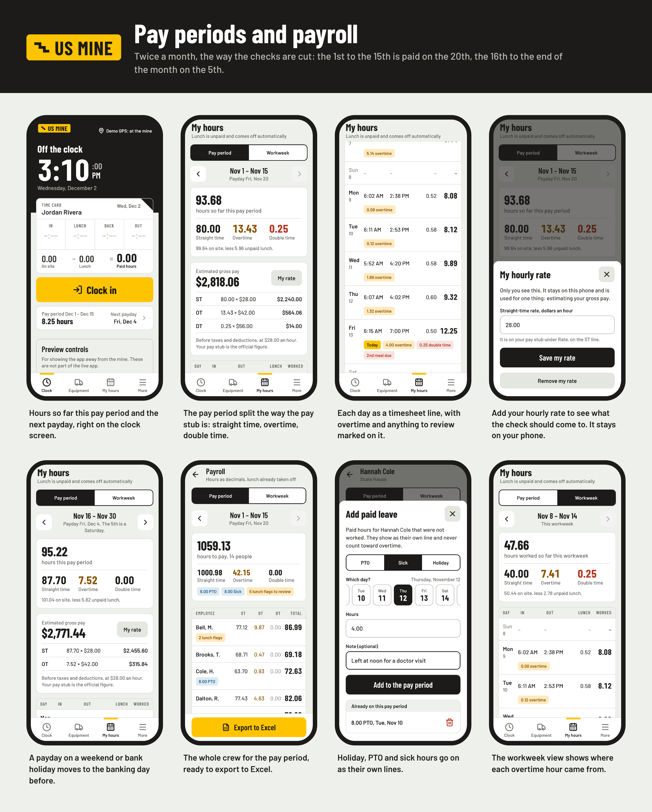
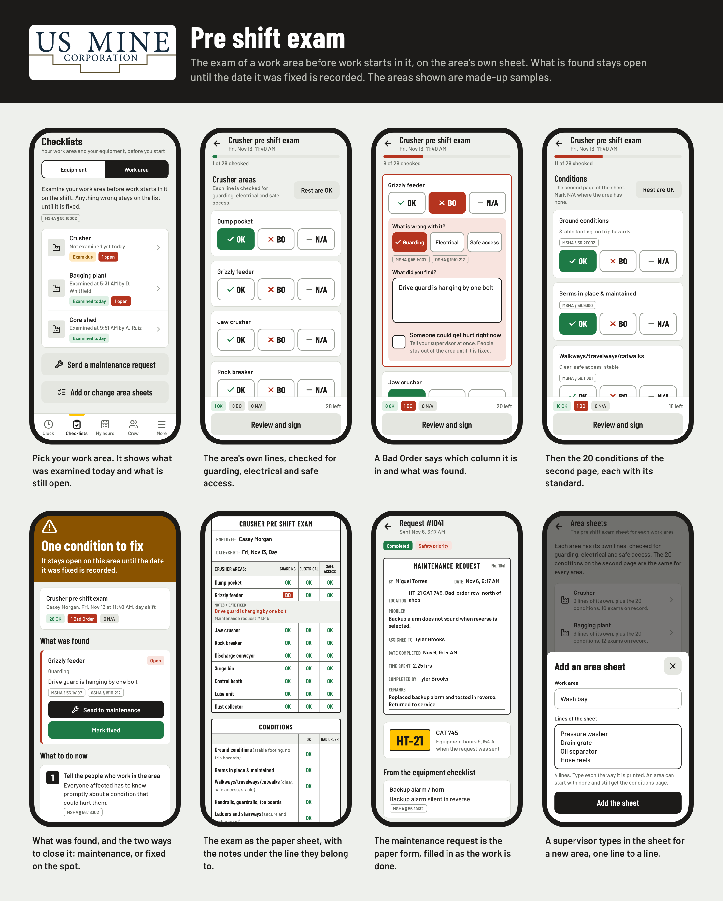
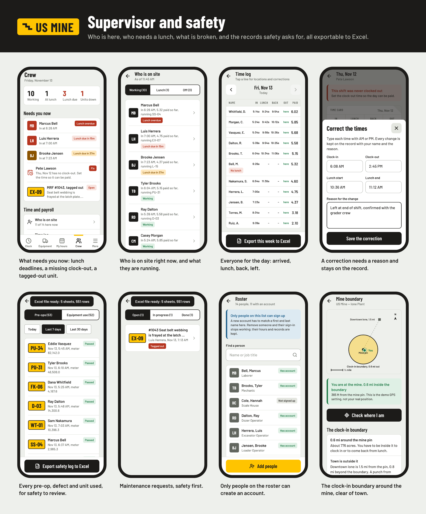
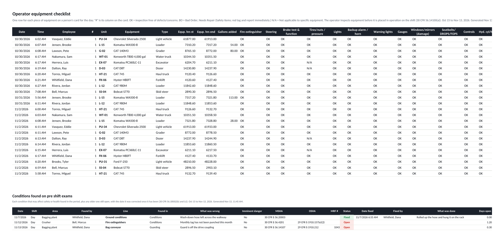

# US Mine Crew

Time clock, the equipment checklist, the pre shift exam of each work area, maintenance requests and payroll hours for the crew at the U.S. Mine Corp. plant in Ione, California. One codebase builds the iPhone app, the Android app and a web version.

It replaces the paper time sheet, the Operator Equipment Checklist card, the Pre Shift Exam sheets and the Maintenance Request form, and it does the hours math so nobody has to.









The Excel exports look like this ([payroll sample](docs/samples/US-Mine-Payroll_sample.xlsx), [safety log sample](docs/samples/US-Mine-Safety-Log_sample.xlsx)):




## What it does

**For everyone on the crew**

- **Clock in and out with a GPS check.** A clock-in only goes through from inside the mine boundary. The location is read at the moment of the punch and never in the background.
- **Lunch is one tap.** Tap Start lunch and that is it. Thirty minutes later the app puts you back on the clock by itself and sends a notification that lunch is over. Nobody clocks back in. Lunch is unpaid and comes off the day as 0.50.
- **Lunch reminders.** The app counts down to the end of the fifth hour of work and reminds you 60, 30 and 15 minutes before it, and again when it passes.
- **Hours the way the timesheet does them.** Minutes become hundredths of an hour (15 min = .25, 45 min = .75). 6:15 AM to 7:00 PM with a 30-minute lunch is 12.75 − 0.50 = **12.25**.
- **Pay periods the way the checks are cut.** The 1st to the 15th is paid on the 20th, and the 16th to the end of the month is paid on the 5th. The clock screen shows the hours so far and the next payday. My hours splits the period into straight time, overtime and double time, the same lines as the pay stub.
- **What the check should come to.** Enter your hourly rate once and the app estimates gross pay for the period. The rate stays on your phone.
- **The Operator Equipment Checklist, the same card for every machine.** The 21 lines of the paper card, in its order and its wording, marked OK, BO or N/A with one big tap each. It takes the equipment hours at the start and the end, the gallons added and the comments. Each line shows the MSHA standard behind it, with the matching OSHA rule.
- **Your card for the day.** Every unit you check gets a numbered column, laid out the way the paper is, with the total daily hours worked filled in from the time clock.
- **Bad Order guidance.** A Bad Order on a safety item red tags the unit, shows the steps to take with the standard for each one, and pre-fills the maintenance request.
- **The Pre Shift Exam of your work area.** The area's own sheet, each line checked for guarding, electrical and safe access, then the 20 conditions of the second page, with room for "Other (specify)" lines. Anything found stays open on the area until the date it was fixed is recorded.
- **Maintenance requests like the paper form.** By, date, location and problem, then assigned to, date completed, time spent, completed by and remarks. A request can be for a unit or for anything else in the plant.

**For supervisors, safety and payroll**

- A live board: who is on site, who is close to their lunch deadline, which shifts have no clock-out, which units are red tagged, and which work-area conditions are still open.
- Time corrections with a required reason and a permanent audit trail.
- Payroll by employee for the pay period or any workweek: straight time, overtime and double time, with lunch flags for review.
- Paid leave: holiday, PTO and sick hours are entered by a supervisor, show as their own lines, and never count toward overtime.
- Everyone's equipment cards and pre shift exams by day, each one opening as the paper it replaces.
- Maintenance request queue: assign a request, start it, and complete it with the remarks and the time spent. Completing a request that came from an exam puts the date fixed on that exam.
- Area sheets: type in the sheet for a new work area, one line of the paper to a line.
- Roster control: only names on the roster can create an account. Paste a whole list at once.
- **Excel exports** for payroll (summary, daily detail, paid leave, punch log, flags) and safety (equipment checklists with the 21 lines as columns, Bad Order items, equipment use, pre shift exams, the conditions found, every line of every exam, maintenance requests, time on site).

## Where this build stands

This is a working preview. Every flow above runs, on sample data.

| | |
|---|---|
| **Runs today** | Time clock, GPS boundary check, lunch rules and reminders, the equipment checklist and the daily card, Bad Order steps, pre shift exams and their open conditions, maintenance requests, area sheets, pay periods and payroll math, paid leave, pay estimate, corrections, roster, Excel export |
| **Sample data** | 14 made-up employees, 14 made-up units, 3 made-up work areas, about five weeks of punches and two weeks of checklists and exams. Nothing in it is a real US Mine record |
| **The mine's own sheets** | The equipment checklist and the conditions page are the mine's, line for line. The area sheets in this repository are made-up samples: a build names the real ones in `.env.local`, or a supervisor types them in (see The paper forms) |
| **Settled with the crew** | The safety items that always red tag a unit: fire extinguisher, steering, brakes, backup alarm / horn, seatbelts and controls. N/A stays on the pre shift exam. The one spelling the app puts right on the conditions page stays put right. There is a swing shift as well as day and night |
| **To confirm with the mine** | The hours each shift runs (see Pre Shift Exam under The paper forms for what the app assumes until then). What "DROPS" on the card stands for (it is shown as printed). Whose name goes on "Completed by" when a supervisor closes out a request for a mechanic (the app asks). What the "Lead Check" blank on some area sheets is for and who fills it in (it is not built yet) |
| **To confirm with payroll** | Which way a pay date moves when the 5th or 20th is a weekend or bank holiday (the app moves it to the banking day before), and which holidays are paid |
| **Kept on the device** | All data lives on the phone or browser it was entered on. Two phones do not see each other's punches yet |
| **Keep the paper for now** | The standard asks for exam records to be kept for a year and shown to MSHA on request. Until the shared backend holds them, a record made in this preview lives on one device, so it does not replace the paper yet |
| **Not connected yet** | The shared cloud database and real Apple, Google and Microsoft sign-in. The buttons and the account screens are built; they need the backend behind them |
| **Not yet tried on a phone** | The iPhone and Android bundles build cleanly, and the app has been driven end to end in a browser. It has not been installed on a physical phone yet |
| **Notifications** | On a phone, the lunch reminders and the lunch-is-over notice are handed to the operating system, so they arrive with the app closed or the phone locked. In a browser they only arrive while the page is open. Delivery on a real phone has not been tried yet |

Going live for the whole crew needs the cloud backend first, so a supervisor's phone can see everyone's punches.

## Run it

```bash
npm install
npm run web        # opens in a browser
npm start          # then scan the QR code with Expo Go on a phone
npm test           # 420 unit tests: hours, lunch rules, overtime, pay periods, roster, GPS, the checklist, exams, Excel
npm run typecheck
npm run build:preview   # packs the whole app into one HTML file in preview/ that opens anywhere
```

The preview file is kept under 2 MB, which is as large as an HTML file can be and still open as a preview in the Claude phone app; a larger one has shown there as code. Its fonts go in as the compressed copies in `scripts/preview-fonts` to keep it that small, and the packer warns when the file gets close.

The sign-in screen has two shortcuts, "Open as an employee" and "Open as a supervisor", that skip account setup. (A build that names its own roster has no sample people to open as; it has one shortcut, for the person the build is made for.) The Clock screen has preview controls for pretending the phone is at the mine or in town, so the GPS check can be shown from anywhere. While at lunch, "Skip to the end of lunch" shows what happens when the 30 minutes are up without waiting for them.

## Signing in under your own name

Only names on the roster can create an account, and the sample crew is made up. To use a build as yourself, name the person the build is for in a file called `.env.local` in the project folder:

```
EXPO_PUBLIC_ROSTER_OWNER=First Last
```

That person is always on the roster as a supervisor. They create an account with their own name, email and password like anyone else, start with no hours, and can add the rest of the crew from Crew → Roster. In a live build this is also how the first supervisor gets in.

### The whole roster

A build can name everyone at the mine as well, each with their job title, so every person can create an account under their own name. In `.env.local`, one person to a line: the name, then the job title, then `supervisor` for a supervisor, with a bar between them. `\n` ends a line. Put the value in single quotes, so a nickname can keep its double quotes:

```
EXPO_PUBLIC_ROSTER='Ortiz, Sam | Crusher\nQuinn, Riley J | Maintenance | supervisor\nVance III, Lee "Buck" | Electrician'
```

- A name is read as "Last, First", the way a sign-in sheet lists it. A middle initial, a nickname in quotes and a "Jr" or "III" stay where the mine wrote them.
- A person signs up with their first and last name. They can leave off the middle initial and the "III", and someone who goes by their nickname can use it. When a name fits more than one person, the app asks for it the way it is on the roster.
- Everyone a build names starts with no hours and no records. Nothing is made up for a real person.
- The person named in `EXPO_PUBLIC_ROSTER_OWNER` is a supervisor whatever their line says. Everyone else is crew until their line says `supervisor`, or a supervisor changes it on the Roster screen.

**A build that names its roster has nobody made up in it.** The sample crew and their sample hours, checklists, exams and requests are left out. It opens with the mine's own people, the area sheets and the equipment list, and nothing that happened: the records are the crew's to make. The sign-in screen offers one shortcut, "Open as" the person the build is made for, and the More screen can clear the device back to that start. What such a build saves on a device is kept apart from the sample data an earlier preview may have saved there.

To show the app with a few weeks of history in it, keep the samples beside the real roster:

```
EXPO_PUBLIC_SAMPLE_CREW=1
```

The made-up people are then marked "Sample" on the Roster screen, and one who happens to have the last name of someone on the real roster starts under a spare one, so the made-up hours are not taken for a real person's. The sample history is never moved onto real people. (`EXPO_PUBLIC_SAMPLE_CREW=0` starts a build that names nobody with none, too.)

`.env.local` is not committed, and that is the point: **this repository is public.** Keep real names, pay figures and other personal details out of the code, out of `src/store/seed.ts`, and out of the screenshots and sample workbooks in `docs/`.

## The paper forms

Three of the mine's paper forms are built in. The app keeps their wording and their order, so a record reads like the sheet it replaces.

**Operator Equipment Checklist.** One card for every piece of equipment at the mine. Its 21 lines are in `src/domain/templates.ts` exactly as printed, from Fire extinguisher to Bed condition, each marked OK, BO or N/A:

```
OK = inspection free of defects/concerns
BO = Bad Order, Needs Repair (Safety items; red tag and report immediately.)
N/A = Not applicable to specific equipment
```

That is the legend at the foot of the card, word for word, and it is what the app shows. The card does not say which lines are the safety items, so the app has to: fire extinguisher, steering, brakes, backup alarm / horn, seatbelts and controls. A Bad Order on one of those always red tags the unit. A note written on a Bad Order goes on the record only while the line is a Bad Order; change the line back to OK and the note is withdrawn with it.

The unit goes on the person's card for the day with its equipment hours at the start. Ending use adds the hours at the end and any gallons added. The card screen lays the day out as the paper does: up to four numbered columns against the lines, the comments, and the legend. A fifth unit starts a second card.

**Pre Shift Exam.** The examination of a work area before work starts in it on the shift. Page one is the area's own sheet: each line is checked for guarding, electrical and safe access. Page two is the same for every area: 20 conditions, each OK or Bad Order. The paper has only those two; the app adds N/A, so a line that does not apply can still be answered. On the phone a line is one tap for OK or N/A; a Bad Order asks which column it is in and what was found. Some sheets have a single OK/BO column in place of the three: a Bad Order on one of those asks only what was found, and the record is shown with the one column. A Bad Order stays open on the area, and on the supervisor's board, until its date fixed is recorded. That happens one of two ways: the examiner or a supervisor marks it fixed, or the maintenance request it was sent on is completed.

A few things the phone does that the paper leaves to the person:

- The "Date+Shift" blank is filled in: the date, and the shift, which is day, swing or night. The form starts on the shift the person clocked in for, and they can change it. Until the mine gives the hours its shifts run, the app takes day crews to come in from 3 AM, swing from 11 AM and nights from 5 PM, and uses that for the starting choice only. The work-area list names the shift an area was last examined for, so the next crew can see that theirs is still to do; it does not work out for them that an exam is due.
- What is written goes under the line it belongs to, under the paper's "Notes / Date fixed" heading, because a phone has no room for that column.
- A line with a condition still open says so when the area is examined again, and "Rest are OK" passes over it, so it is looked at and marked by hand. Marking it OK does not close the earlier finding: only its own date fixed does. The same line found again on a later exam is a record of its own.
- A Bad Order marked as a danger shows as "Danger, keep out" wherever the area is listed, ahead of anything else that is open.
- Leaving a half-filled exam or checklist asks first, so a back swipe in gloves does not throw the marks away. Each is signed once, however many times the button lands.

**Maintenance Request.** By, date, location and problem when it is sent; assigned to, date completed, time spent, completed by and remarks as the work is done. A supervisor assigns it. A supervisor, or the person it is assigned to, starts and completes it; the person it is assigned to finds it on their Clock screen and under My records. "Completed by" is whoever closes it. A supervisor closing one out for the person it is assigned to is asked who did the work, and the history shows who entered it. A request is only ever for something that is there: a unit in the fleet, a checklist made on that unit, or a Bad Order that is still open and has no request yet. The crew calls the form an MRF, so the exports head its number "MRF #".

### Area sheets

Every work area has its own sheet. The three in this repository are made-up samples, because the real sheets list the plant's own equipment and the repository is public. There are two ways to put the real ones in:

- **In the app:** Crew → Area sheets → Add an area sheet. Type the name of the area, then one line of the paper sheet on each line. An area can start with no lines of its own and still get the conditions page. Turn on "One OK/BO column" for a sheet that marks each line once.
- **For a build:** name them in `.env.local`. The name of an area, then each line of its sheet, with a blank line before the next area. `\n` ends a line, and `[OK/BO]` after the name of an area gives its sheet the one column:

```
EXPO_PUBLIC_AREA_SHEETS="North plant\nFeed bin\nConveyor 4\nJaw crusher\n\nCore shed [OK/BO]\nCore saw\nCore racks"
```

A signed exam keeps the lines and the columns it was made on, so changing a sheet later never changes a record.

## How the hours are figured

1. Punches count to the minute.
2. Time on site becomes a decimal: minutes ÷ 60, rounded to two places.
3. Lunch becomes a decimal the same way and comes off: paid = on site − lunch.
4. Days add up to weeks as whole hundredths, so the app, the timesheet and the Excel export always agree.

Lunch ends by itself 30 minutes after it starts, so it comes off as 0.50. A second lunch on a long day works the same way. If a supervisor corrects a lunch to a different length, the corrected minutes come off instead. Paid rest breaks can be logged but are never taken off.

## How lunch works

1. The person taps **Start lunch**. That is the only tap.
2. The app writes down the end of the lunch right then: 30 minutes after the start. The screen turns blue and counts down.
3. When the 30 minutes are up the person is back on the clock, whether the app is open or not. Nothing has to be running for this to happen, because being at lunch is worked out from the two times.
4. The phone shows a notification: "Lunch is over. You are back on the clock as of 11:30 AM." If the app is open it says so on screen as well.

A lunch cannot be cut short or stretched from the phone, and there is no clock-out while it is running. There is no punch at the end of lunch, so no location is read then: the app does not check that someone is back at the mine when their lunch ends. Supervisors can still correct lunch times, with a reason, from the shift record.

Overtime follows California rules: over 8 hours in a day or 40 straight-time hours in a week is time-and-a-half, over 12 in a day is double time, and the seventh-day rule applies. The lunch deadline follows California Labor Code §512: the first meal starts before the end of the fifth hour. Flags are for a supervisor to review. Nothing is paid or docked automatically.

## Pay periods and paydays

| Pay period | Paid on |
|---|---|
| The 1st to the 15th | The 20th of the same month |
| The 16th to the end of the month | The 5th of the next month |

- **A pay date on a weekend or bank holiday moves to the banking day before it.** Saturday, December 5, 2026 becomes Friday, December 4. Bank holidays are the Federal Reserve's; a holiday on a Sunday closes banks the Monday after. This is the app's assumption until payroll confirms which way the date moves. The schedule is `PAY_SCHEDULE` in `src/domain/payPeriod.ts`.
- **Overtime is figured by the workweek, Sunday to Saturday,** then added up for the days that fall in the pay period. A workweek that straddles two pay periods is worked out whole, and each day's hours go to the period the day is in.
- **Hours come in the pay stub's lines:** ST (straight time), OT (1.5 times), DT (2 times), and holiday, PTO and sick hours. Paid leave is paid at straight time and never counts toward overtime.
- **The pay estimate** is hours times the rate the person entered, line by line, each line rounded to the cent: ST at the rate, OT at 1.5 times, DT at 2 times, leave at the rate. It is gross pay before taxes and deductions. The pay stub is the official figure.

## The clock-in boundary

The boundary is a circle around the pin at 38.33419° N, 120.94551° W, 1,000 m (0.62 mi) out by default, which is about 776 acres.

The Central Valley Water Board permit for the site (Order R5-2025-0042, June 2025) describes the US Mine Ione Plant as about 1.25 miles south of Ione on roughly 3,570 acres, of which about 402 acres have been mined, built on or reclaimed, all south of town and west of Highway 124. A circle the size of the full 3,570 acres centered on the pin would reach the south side of town, so the default covers the working area and stops about 0.8 miles short of downtown.

Supervisors can change the radius in the app (Crew → Mine boundary). To use the true property outline instead, set `polygon` on the site in `src/domain/site.ts`; the parcel numbers from the permit are listed there.

## Standards

Ione is a surface non-metal mine, so the governing federal standards are MSHA's 30 CFR Part 56. Each safety check also shows the matching federal OSHA rule (29 CFR 1910 / 1926) as a cross-reference. In California, Cal/OSHA's Mining and Tunneling Unit also inspects surface mines under the Title 8 Mine Safety Orders.

- The equipment checklist is the operator's inspection before equipment is placed in operation on the shift, 30 CFR 56.14100.
- The pre shift exam is the examination of working places, 30 CFR 56.18002. Its record names who made the examination, the date, the areas examined and each condition found, and the date a condition is corrected is added to it. The app's exam record carries each of those.
- Two lines of the conditions page fall under other parts of 30 CFR: container labels (Part 47) and hearing protectors (Part 62).
- No standard is cited beside dust control or respiratory protection. 30 CFR 56.5005 was being revised when the list was written, so those two lines carry no reference until the current text is checked.

Only standards whose text has been checked are cited. The summaries in the app are a field aid in plain language. They are not legal advice.

## Making it yours

| To change | Edit |
|---|---|
| Equipment checklist lines, and which are safety items | `src/domain/templates.ts` |
| Pre shift exam columns and the 20 conditions | `src/domain/areaExam.ts` |
| Area sheets | In the app (Crew → Area sheets), or `EXPO_PUBLIC_AREA_SHEETS` in `.env.local` |
| Roster | In the app (Crew → Roster), or `EXPO_PUBLIC_ROSTER` in `.env.local` |
| Standards and the steps after a Bad Order | `src/domain/standards.ts` |
| Lunch and overtime rules | `CA_RULES` in `src/domain/time.ts` |
| Pay periods, paydays and bank holidays | `src/domain/payPeriod.ts` |
| Boundary | `src/domain/site.ts`, or in the app |
| Sample crew and fleet | `src/store/seed.ts` |
| Colours and type | `src/theme/theme.ts` |
| Company logo | `src/components/logoArt.ts`, drawn by `Logo` in `src/components/Brand.tsx` |

The real roster and fleet can also be entered in the app: Crew → Roster → Add people → Paste a list.

## The logo

The sign-in screen, the Clock screen, the app icon and the launch screen carry US Mine Corporation's own logo: the navy lettering over the gold stepped rule. It is always shown on white, in its own colours and proportions.

The logo in this build was traced from a screenshot the company's artwork was supplied in, so it is sharp at any size but its finest details are only as good as that screenshot. Before a store release, regenerate `src/components/logoArt.ts` and the files in `assets/` from the company's original artwork (an SVG, PDF or large PNG), and have the company sign off on how its logo is used.

## How the code is laid out

```
App.tsx                 fonts, storage, navigation
src/domain/             the rules, with tests: hours, lunch, overtime, pay periods, GPS, the checklist, exams, standards
src/store/              app state (saved on the device), its migrations and the sample data
src/services/           GPS, notifications, Excel writer, reports, file sharing
src/components/         buttons, time card, the paper forms, day table, pay estimate, danger tag, site map
src/screens/            auth, clock, equipment, exam, hours, more, supervisor
```

Built with Expo (React Native) and TypeScript.

## Before the first store release

- Make this repository private, or keep the real roster and the real area sheets in the backend only. Real employee names and the plant's own sheets must never be committed while it is public.
- The mine's sign-off on which checklist lines are safety items, and on each area sheet as typed in.
- Connect the backend and turn off preview mode (`EXPO_PUBLIC_DEMO=0`).
- Set the real app identifiers in `app.json` (`ios.bundleIdentifier`, `android.package`). They are placeholders now and cannot be changed after the first release.
- Apple Developer Program and Google Play Console accounts in the company's name.
- The logo regenerated from the company's original artwork, with the company's sign-off on its use.
- A privacy policy that covers the location check.
